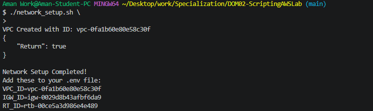
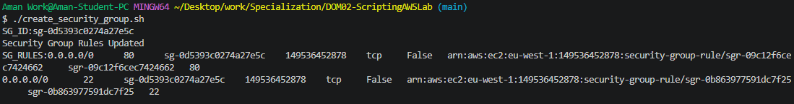
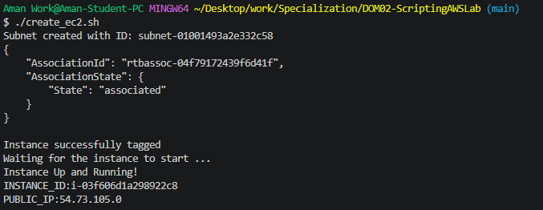
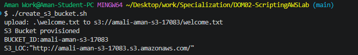
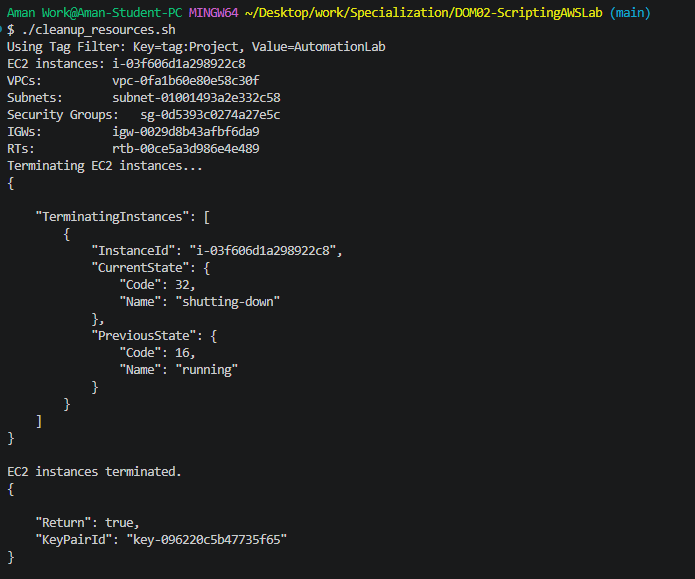
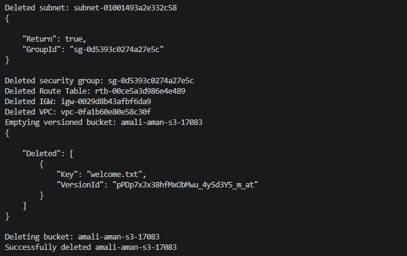

# AWS Infrastructure Automation Lab

This repository contains Bash scripts that use the AWS CLI to automate the provisioning and cleanup of core AWS infrastructure: a VPC, an Internet Gateway, a route table, a security group, a subnet, an EC2 instance and a versioned S3 bucket.

## Scripts

| Order | Script | Description |
|-------|--------|-------------|
| 1 | `network_setup.sh` | Creates the base VPC (`10.0.0.0/16`), an Internet Gateway (IGW) and a custom route table with a default route (`0.0.0.0/0`) to the IGW. Prints the IDs needed by later steps. |
| 2 | `create_security_group.sh` | Creates a security group in the VPC with inbound rules for SSH (port 22) and HTTP (port 80). |
| 3 | `create_ec2.sh` | Generates an SSH key pair, creates a public subnet (`10.0.0.0/24`), associates the route table, launches a `t3.micro` EC2 instance with a public IP and waits for it to reach the `running` state. |
| 4 | `create_s3_bucket.sh` | Creates a uniquely named S3 bucket, enables versioning, tags it for lab tracking and uploads a sample `welcome.txt`. |
| 5 | `cleanup_resources.sh` | Finds every resource tagged `Project=AutomationLab` and deletes them in dependency order. |

## Prerequisites

- **AWS CLI v2**, installed and configured with `aws configure`.
- **Bash.** On Windows, use Git Bash (MINGW64).
- **IAM permissions.** The scripts need EC2 and S3 access.

## Setup

1. Create a `.env` file in the repository root:

   ```dotenv
   REGION=eu-west-1
   T1_KEY=Project
   T1_VALUE=AutomationLab
   KEY_NAME=amali-ec2-pair
   ```

2. If you are on Windows, make sure `.env` uses Unix line endings. Windows line endings (CRLF) add a hidden `\r` to every value and break the AWS CLI calls:

   ```bash
   sed -i 's/\r$//' .env
   ```

3. Make the scripts executable:

   ```bash
   chmod +x *.sh
   ```

Every script must load the environment file with `source .env`.

## Walkthrough

Run the steps in order.

### Step 1: Network infrastructure

```bash
./network_setup.sh
```

Creates the VPC, IGW and route table. Copy the printed IDs into `.env`:

```dotenv
VPC_ID=vpc-xxxxxxxxx
IGW_ID=igw-xxxxxxxxx
RT_ID=rtb-xxxxxxxxx
```

### Step 2: Security group

```bash
./create_security_group.sh
```

Creates the security group and opens ports 22 and 80.

Add the SG_ID to .env.

```dotenv
SG_ID:sg-xxxxxxxxx
```


### Step 3: EC2 instance and subnet

```bash
./create_ec2.sh
```

Creates the `10.0.0.0/24` subnet, associates the route table, saves `amali-ec2-pair.pem` and launches a `t3.micro` instance.

### Step 4: S3 bucket

```bash
./create_s3_bucket.sh
```

Creates the versioned bucket and uploads `welcome.txt`.

### Step 5: Cleanup

```bash
./cleanup_resources.sh
```

Discovers all resources tagged `Project=AutomationLab` and deletes them in this order:

1. EC2 instances (waits until they are terminated)
2. Key pair and local `.pem` file
3. Subnets
4. Security groups
5. Custom route tables
6. Internet Gateways (detached first, then deleted)
7. VPCs
8. S3 buckets (all object versions and delete markers removed first)

> **Important:** cleanup finds resources by tag. Any resource created without the `Project=AutomationLab` tag will be skipped and can block VPC deletion. Tag everything at creation time, for example with `--tag-specifications`, or with `aws ec2 create-tags --resources <id> --tags Key=Project,Value=AutomationLab`.

## Challenges and resolutions

### 1. Subnet CIDR out of range (`InvalidSubnet.Range`)

**Problem:** Creating a `10.0.1.0/24` subnet failed because the VPC was `10.0.0.0/24`. A subnet's CIDR must fall inside the VPC's range.

**Resolution:** The VPC is now `10.0.0.0/16` in `network_setup.sh`, and the subnet is `10.0.0.0/24` in `create_ec2.sh`.

### 2. Invalid tag filter syntax (`InvalidParameterValue`)

**Problem:** EC2 `describe-*` commands need tag filters in the form `Name=tag:KEY,Values=VALUE`. Passing `Name=Project` returned `The filter 'Project' is invalid`.

**Resolution:** The key is normalized so it always has exactly one `tag:` prefix:

```bash
FILTER_KEY="tag:${T1_KEY}"
```

### 3. VPC deletion failed (`DependencyViolation`)

**Problem:** `cleanup_resources.sh` kept failing to delete the VPC because an Internet Gateway and a custom route table were still attached to it. There were two causes:

- **Broken filter strings.** The route table and IGW lookups used `"Name=tag:"Name=tag:$FILTER_KEY",..."`, and later `"Name=tag:"$FILTER_KEY",..."`. Because `FILTER_KEY` already contains `tag:`, these became `tag:Name=tag:tag:Project` and `tag:tag:Project`, which matched nothing. The fix was to use `"Name=$FILTER_KEY,Values=$T1_VALUE"`, the same form as the other lookups.
- **Untagged resources.** Even with the filter fixed, the IGW and route table were never tagged when they were created, so a tag filter could not find them.

**Resolution:**

- Corrected the filters.
- Diagnosed the leftover dependencies by listing everything in the VPC by VPC ID:

  ```bash
  VPC=vpc-xxxxxxxxx
  aws ec2 describe-internet-gateways  --filters Name=attachment.vpc-id,Values=$VPC
  aws ec2 describe-subnets            --filters Name=vpc-id,Values=$VPC
  aws ec2 describe-security-groups    --filters Name=vpc-id,Values=$VPC
  aws ec2 describe-route-tables       --filters Name=vpc-id,Values=$VPC
  aws ec2 describe-network-interfaces --filters Name=vpc-id,Values=$VPC
  ```

  The `default` security group and the main route table are deleted automatically with the VPC. Anything else returned is a blocking dependency.

- Removed the leftover resources manually by ID:

  ```bash
  aws ec2 detach-internet-gateway --internet-gateway-id igw-xxx --vpc-id vpc-xxx
  aws ec2 delete-internet-gateway --internet-gateway-id igw-xxx
  aws ec2 delete-route-table      --route-table-id rtb-xxx
  aws ec2 delete-vpc              --vpc-id vpc-xxx
  ```


- Kept the cleanup order of instances, subnets, security groups, route tables, IGWs and then the VPC, with a `sleep 5` after detaching the IGW.

### 4. EC2 launch blocked by an SCP (`UnauthorizedOperation`, explicit deny)

**Problem:** `run-instances` failed with an explicit deny from an organization Service Control Policy, even though the IAM user is in an `admins` group with `AdministratorAccess`.

**Resolution:** Decoding the authorization message showed that the `LimitEC2InstanceTypes` statement only allows `t3.micro`, `t3.small` and `t3.medium`, while the script requested `t2.micro`. Switching to `--instance-type t3.micro` fixed it.

### 5. Invalid S3 endpoint (`https://s3..amazonaws.com`)

**Problem:** `create_s3_bucket.sh` checked that `.env` existed but never sourced it. `REGION` was therefore empty, and the CLI built an endpoint with nothing between the dots.

**Resolution:** Added `source .env` after the existence check.


## Future Improvements

### Single orchestration script

Currently, each script is run manually in sequence, and the IDs from `network_setup.sh` are copied into `.env` by hand. The next step is a single `deploy.sh` that runs the whole workflow in one command:

```bash
./deploy.sh          # provision everything
./deploy.sh destroy  # tear everything down
```

Planned behavior:

- **Run all steps in order**: `network_setup.sh` → `create_security_group.sh` → `create_ec2.sh` → `create_s3_bucket.sh`.
- **Pass outputs automatically**: write `VPC_ID`, `IGW_ID`, `RT_ID`, `SG_ID`, `SUBNET_ID`, `INSTANCE_ID` and `BUCKET_ID` to `.env` (or export them) as each step finishes, so nothing has to be copied by hand.
- **Tag everything at creation**: apply `Project=AutomationLab` to every resource, including the IGW and route table, so `cleanup_resources.sh` can always find them.
- **Clean up on partial failure**: optionally call `cleanup_resources.sh` if provisioning fails partway, so no orphaned resources are left behind.
- **Log clearly**: show each step's status (`[1/4] Creating network...`) and print a summary of the created resource IDs at the end.


## Screenshots of Scripts Successfully Running

Creating the Network Configuration for the EC2


Creating the Security Group and its rules


Creating the EC2 Instance


Creating the S3 Bucket


Cleaning Up the Resources

